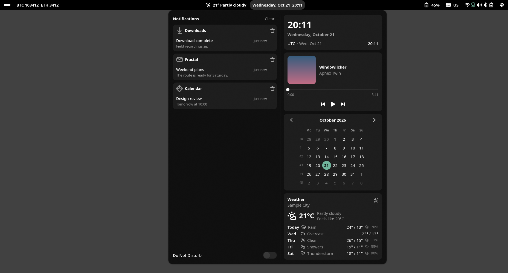
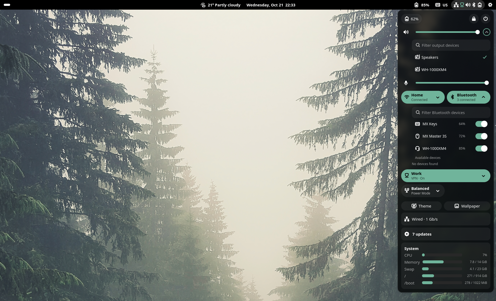
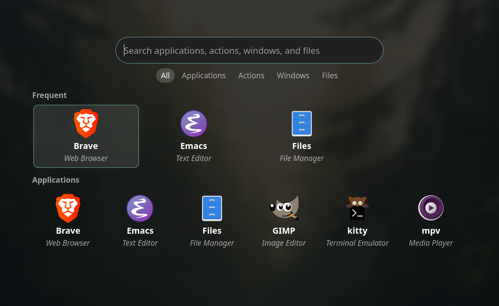
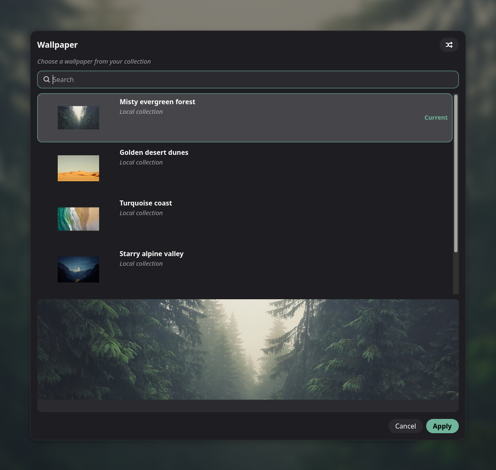

<h1 align="center">
  
</h1>
<p align="center">A GNOME Shell-inspired top bar for niri and Mango.</p>
<p align="center">
  <a href="https://github.com/trevarj/topbar/actions/workflows/ci.yml"></a>
  <a href="LICENSE"></a>
  <a href="https://www.rust-lang.org/"></a>
  <a href="#install"></a>
</p>
<p align="center">
  <a href="#install">Install</a> · <a href="docs/configuration.md">Configuration</a> · <a href="#links">Documentation</a>
</p>
<p align="center">Not affiliated with or endorsed by the GNOME Project.</p>

**Contents:** [Screenshots](#screenshots) · [Features](#features) · [Install](#install) · [Running under niri](#running-under-niri) · [Running under Mango](#running-under-mango) · [Configuration](#configuration) · [Links](#links) · [License](#license)

## Screenshots



Control center: notifications, media and the day ahead.



Quick settings: connected peripherals, audio outputs and system controls.



Launcher: frequent applications and unified search.



Wallpaper picker: browse and preview a local collection.

## Features

- **One continuous panel.** Full-width on every monitor, with monitor-aware
  workspace dots, names or indices and urgency indicators, keyboard layout
  and a distro indicator.
- **Control center and notifications.** Grouped notification history, Do Not
  Disturb, calendar, world clocks, MPRIS media controls and forecast.
  Notification banners and an unseen-history indicator keep arrivals visible.
- **Quick settings.** Wired networking, Wi-Fi passwords, Bluetooth pairing,
  stored-profile VPN, output-device selection, volume and microphone,
  brightness, power profiles, Caffeine, battery health and charge limits,
  updates, resource overview and privacy indicators. Lock directly; hold to
  confirm logout, suspend, restart or shutdown. See the
  [optional rows and VPN limitations](docs/configuration.md#widgetsquick_settings);
  VPN plugins' interactive authentication dialogs are not supported.
- **Launcher.** Fuzzy Applications, Actions, Windows and Files search, frequent
  apps, window focusing and file actions. Open it with `topbar launcher toggle`.
- **Weather.** Location search, Celsius or Fahrenheit and a multi-day forecast.
- **Quiet indicators.** Tray icons with menus and overflow, resource alerts
  that stay hidden while healthy, and headset battery status.
- **Optional data widgets.** BTC, ETH and XMR prices and pair ratios, unread
  mail from an existing notmuch index, and Waybar-compatible custom scripts.
- **Appearance.** Dark and light palettes, accent and custom colors, optional
  compositor blur, animation controls, widget placement and click actions.
  Theme and Wallpaper integrations run your configured commands, not an
  included wallpaper backend.
- **Live configuration.** Reload on save, retaining the last valid configuration
  when a file is invalid. Volume and brightness media keys show an OSD.
- **Standalone tools.** List, theme and wallpaper choosers through
  `topbar choose --title ...`, plus GnuPG pinentry through `topbar pinentry`.

## Install

```sh
nix run github:trevarj/topbar
```

The flake currently supports `x86_64-linux`. To install through a NixOS flake:

```nix
# flake.nix
{
  inputs.topbar.url = "github:trevarj/topbar";

  outputs = { nixpkgs, topbar, ... }: {
    nixosConfigurations.yourhost = nixpkgs.lib.nixosSystem {
      modules = [
        ({ pkgs, ... }: {
          nixpkgs.overlays = [ topbar.overlays.default ];
          environment.systemPackages = [ pkgs.topbar ];
        })
      ];
    };
  };
}
```

## Running under niri

Add to `~/.config/niri/config.kdl`:

```kdl
spawn-at-startup "topbar"

binds {
    Mod+Space { spawn "topbar" "launcher" "toggle"; }
    XF86AudioRaiseVolume allow-when-locked=true { spawn "topbar" "volume" "inc" "5"; }
    XF86AudioLowerVolume allow-when-locked=true { spawn "topbar" "volume" "dec" "5"; }
    XF86AudioMute        allow-when-locked=true { spawn "topbar" "volume" "toggle-mute"; }
    XF86MonBrightnessUp   { spawn "topbar" "brightness" "inc" "5"; }
    XF86MonBrightnessDown { spawn "topbar" "brightness" "dec" "5"; }
}
```

The panel reserves an exclusive zone so niri lays windows out beneath it.
Volume and brightness commands work without a running panel, including when
its configuration is broken; the OSD is optional feedback.

<details>
<summary>Optional compositor blur</summary>

Set `blur = true` under `[theme]` in topbar's configuration and add this to
niri's configuration:

```kdl
layer-rule {
    match namespace="^topbar$"
    match namespace="^topbar-popover$"

    background-effect {
        xray false
    }
}
```

</details>

## Running under Mango

Mango 0.18.2 is supported alongside niri. Run `topbar` from your Mango session;
if automatic desktop detection cannot identify it, select the backend explicitly:

```toml
[advanced]
compositor = "mango"

[advanced.mango]
# Optional: keep these one-based tags visible when empty.
# persistent_tags = [1, 2, 3]
# Optional: exact full XKB names in Mango's configured order.
# keyboard_layouts = ["English (US)", "Russian"]
```

Both metadata lists default to empty. Without keyboard metadata, workspace and
window integration still work, but keyboard switching is disabled. Selecting a
different backend or changing either metadata list requires restarting topbar;
a reload rejects the entire candidate without applying other changes.
See the [backend and metadata reference](docs/configuration.md#advanced) for
automatic selection, keyboard semantics, and the stock Mango hot-unplug race.

## Configuration

Configuration lives at `~/.config/topbar/config.toml`. Every key is optional;
omitted keys use built-in defaults. Changes apply live, except the compositor
selector and Mango metadata, which require a restart. An invalid file leaves
the last valid configuration running.

The control center shown above is opt-in:

```toml
[widgets.clock]
control_panel = true
```

Inspect the shipped defaults and validate your configuration without
replacing an existing file:

```sh
topbar --print-example-config
topbar --check-config
```

See the [example configuration](config.toml) and
[configuration reference](docs/configuration.md) for options, lookup order and
integrations. Upgrading from gnome-topbar? Read
[Coming from v1](docs/configuration.md#coming-from-v1).

## Links

- [Configuration reference](docs/configuration.md)
- [Example configuration](config.toml)
- [Development and integration reference](DEVELOPMENT.md)
- [Architecture](docs/architecture.md)
- [Report an issue](https://github.com/trevarj/topbar/issues)
- [niri](https://github.com/niri-wm/niri)

## License

[MIT](LICENSE).
